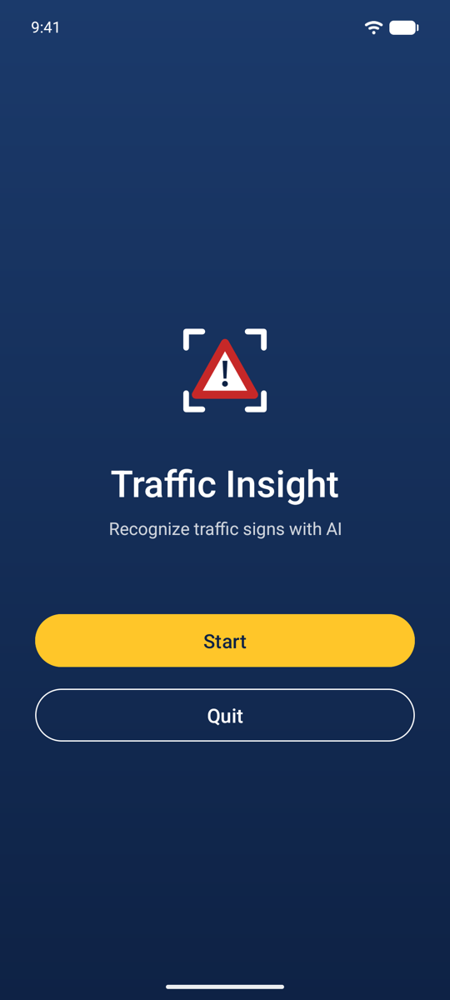
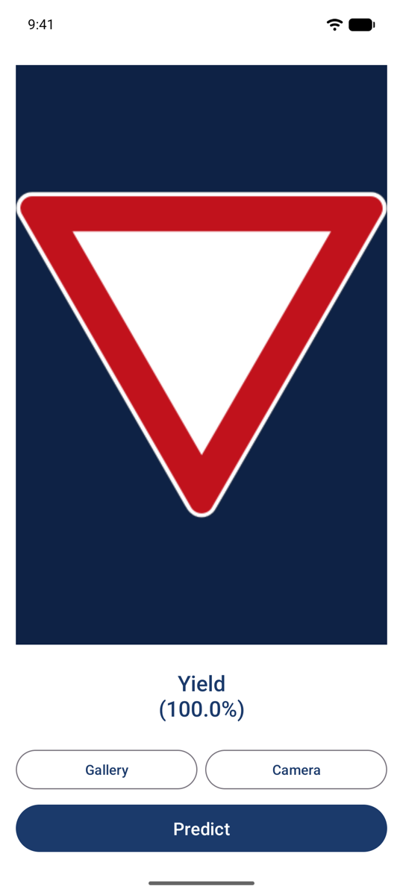

# Traffic Insight Sign Recognition Mobile App V2

Android app that recognizes traffic signs from a photo. Pick a photo from your gallery or take one with the camera, and the app classifies the sign with an on-device TensorFlow Lite (LiteRT) model, showing the result with a confidence score.

This was our university graduation project. The model is trained on the 43 classes of the [GTSRB (German Traffic Sign Recognition Benchmark)](https://www.kaggle.com/datasets/meowmeowmeowmeowmeow/gtsrb-german-traffic-sign) dataset: speed limits, stop, yield, no entry, pedestrian crossing and more. This new version comes with a redesigned UI and updated software versions.

## Features

- **Pick from gallery:** uses Android's system photo picker (no permissions needed)
- **Take a photo:** captures a single photo with the device's camera app and classifies it
- **On-device inference:** no internet needed; the model ships inside the APK (1 MB)
- **Low-confidence handling:** shows "Not recognized" when the model isn't confident enough
- **Reproducible model:** the notebook in `training/` retrains the model from scratch

## Screenshots

<p>
  
  
</p>

## How it works

The photo is resized to 30x30 and passed to a small CNN (`app/src/main/assets/traffic_sign_model.tflite`). The class with the highest score is shown along with its confidence. If the confidence is below 80% the app says "Not recognized" instead of guessing.

The model reaches 98.2% accuracy on the 12,630 images of the GTSRB test set (trained on Colab with a T4 GPU, results are in the notebook).

For best results the sign should fill most of the photo, since the model only classifies, it doesn't detect where the sign is.

## Project structure

```
app/src/main/
├── assets/
│   ├── traffic_sign_model.tflite   # 30x30 RGB input, 43-class output
│   └── labels.txt                  # class names, in ClassId order
└── java/com/example/trafficsigns/
    ├── LoginPage.kt                # start screen
    ├── MainActivity.kt             # gallery / camera / predict screen
    └── SignClassifier.kt           # loads and runs the TFLite model
training/
├── train_traffic_signs.ipynb       # GTSRB training and TFLite export
└── requirements.txt
```

## Running the app

Requirements: Android Studio (recent version), JDK 25, Android SDK 37.2. Runs on Android 10 and newer.

1. Clone the repo and open it in Android Studio.
2. Wait for the Gradle sync to finish.
3. Pick an emulator or device and press Run.

From the command line:

```bash
./gradlew assembleDebug
```

## Retraining the model

```bash
cd training
pip install -r requirements.txt
jupyter notebook train_traffic_signs.ipynb
```

The notebook downloads the dataset from Kaggle, trains the model, evaluates it on the test set and overwrites `app/src/main/assets/traffic_sign_model.tflite`. It also runs on Google Colab or Kaggle with a GPU; there the trained model is saved next to the notebook so you can download it.

## Tech stack

| Component | Version |
|---|---|
| Android Gradle Plugin | 9.4.1 |
| Gradle | 9.8.2 |
| Kotlin | 2.4.21 |
| compileSdk / targetSdk | 37.2 / 37 (Android 17) |
| JDK (target) | 25 |
| LiteRT (TensorFlow Lite) | 2.3.0 |
| TensorFlow (training) | 2.21+ |
